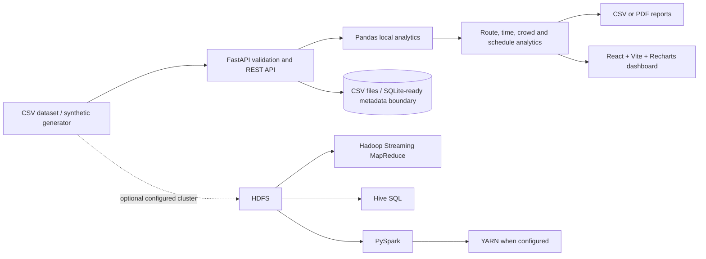
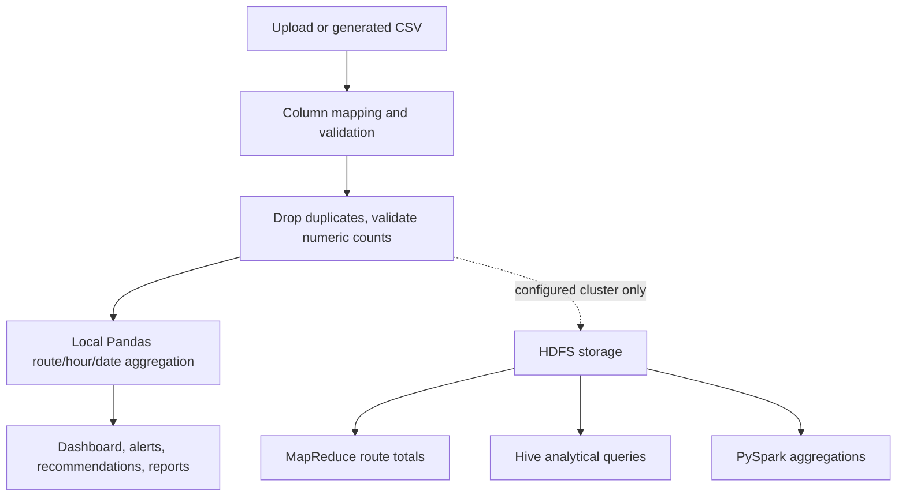

# TransitIQ — Public Transport Analytics and Optimization

TransitIQ is a demonstrable Big Data Tools & Techniques mini-project for route demand analysis, peak-hour insights, occupancy assessment and schedule recommendations. The supplied sample is **synthetic simulated data**, not a government or operator dataset. Local Python/Pandas is the default and is explicitly labeled in the UI and API. Hadoop/HDFS, Hadoop Streaming, Hive, Spark and YARN run only when installed and configured; their command availability is reported rather than assumed.

## Problem and objectives

Transport planners need to understand where and when demand occurs. TransitIQ ingests event-level transport CSV data, validates common columns, aggregates demand by route, date and hour, highlights capacity pressure, and derives service suggestions from observed history. It does not track passenger identities. Recommendations are analytical prompts requiring operational approval.

## Architecture





## Modules

- Dashboard with live backend KPIs, route ranking, daily passenger trend, hourly volume, filters and a detected local execution mode.
- Route analytics, peak-hour charts, aggregate stop patterns, crowd assessment and recommendation pages.
- CSV upload, schema alias mapping, preview, required-field validation, missing-value and duplicate counts, cleaning and download.
- Local processing history, Hadoop tool detection, Streaming mapper/reducer, Hive SQL, optional PySpark job and reference HDFS commands.
- Downloadable CSV/PDF reports and timestamped demand/processing notifications.

## Stack

React 18, Vite, Tailwind-ready CSS design system, Recharts and Lucide React; FastAPI, Pandas, Python; optional Hadoop 3.x/HDFS/Streaming, Hive, PySpark/YARN; CSV dataset storage. FastAPI's API docs are available at `/docs`.

## Dataset

`datasets/sample/transit_sample.csv` is generated with 100,000 deterministic simulated passenger events, 10 routes, 8 stops, varied capacities, weekday/weekend effects and commute-hour demand. It contains date, time, route/stop IDs and names, passenger/boarding/alighting counts, vehicle/capacity, trip and transport type. Generate a larger test file:

```powershell
python datasets/generate_sample.py --rows 1000000 --output datasets/raw/transit_1m.csv
```

## Run locally

From this folder, install dependencies and generate the checked-in sample if absent:

```powershell
python -m venv .venv
.venv\Scripts\Activate.ps1
pip install -r requirements.txt
python datasets/generate_sample.py --rows 100000
uvicorn backend.main:app --reload --port 8000
```

In another terminal:

```powershell
cd frontend
npm install
npm run dev
```

Open the Vite URL (normally `http://localhost:5173`). Set `VITE_API_URL` if the API is hosted elsewhere. The UI provides an honest local mode when Hadoop/Spark are not configured.

## API

Interactive OpenAPI docs: `http://localhost:8000/docs`. Main routes: `GET /api/health`, `/api/filters`, `/api/dashboard`, `/api/routes`, `/api/peak-hours`, `/api/patterns`, `/api/crowd`, `/api/recommendations`, `/api/processing`, `/api/hive/queries`, `/api/notifications`; `POST /api/datasets/upload`, `/api/datasets/clean?dataset=...`, `/api/processing/run`; `POST /api/notifications/{id}/read`; `GET /api/reports/{daily|routes|peak|crowd|recommendations}?format=csv|pdf`.

Column aliases are mapped to canonical `date`, `time`, `route_id`, `route_name`, `stop_id`, `stop_name`, `passenger_count`, boarding/alighting counts, vehicle ID/capacity, trip ID and transport type. Required analytic fields are date, time, route ID and passenger count. Upload accepts CSV up to 100 MB.

## Hadoop integration (optional)

Hadoop 3.4.3 and the `hadoop`/`hdfs` launchers are present on PATH in the current environment, but HDFS is **not runnable yet**: `D:\hadoop\etc\hadoop\core-site.xml` contains two `<configuration>` roots (XML parser error at line 26), and `D:\hadoop\bin\winutils.exe` is missing. The current account also cannot write the configured Hadoop audit log under `D:\hadoop\logs`. The app reports the CLI separately from usable Hadoop prerequisites and continues in Local mode. Repair those host-level prerequisites, start the NameNode/DataNode services, then verify `hdfs dfs -ls /` before claiming a distributed run. Spark and Hive CLIs were not detected.

Example HDFS setup and transfer:

```bash
hdfs dfs -mkdir -p /transitiq/input /transitiq/processed
hdfs dfs -put -f datasets/sample/transit_sample.csv /transitiq/input/
hdfs dfs -ls /transitiq/input
hdfs dfs -cat /transitiq/input/transit_sample.csv | head
```

Hadoop Streaming example (set `STREAMING_JAR` to the Hadoop installation's streaming jar and use an environment with Python on worker PATH):

```bash
hadoop jar "$STREAMING_JAR" \
  -files bigdata/mapreduce/route_passengers.py,bigdata/mapreduce/route_passengers_reduce.py \
  -mapper "python3 route_passengers.py" -reducer "python3 route_passengers_reduce.py" \
  -input /transitiq/input/transit_sample.csv -output /transitiq/processed/route_totals
hdfs dfs -cat /transitiq/processed/route_totals/part-*
```

The scripts in `bigdata/mapreduce/` implement a Streaming mapper and reducer. For classroom workflow demonstration without a cluster, `python bigdata/scripts/run_local_mapreduce.py` executes these stages locally and prints an explicit local-simulation label.

Hive table and analytical examples: `bigdata/hive/transit_queries.sql`. Adapt the external table `LOCATION` and date/time parsing to the CSV import convention of your Hive installation. PySpark job: `spark-submit bigdata/spark/analytics.py <input.csv-or-hdfs-path> <output-path>`. Submit through YARN only when a configured Spark-on-YARN environment is available. YARN resource information is not fabricated; no YARN API integration is claimed.

## Demonstration sequence

1. Generate the sample and start the API/UI.
2. Explore the dashboard and route/date filters.
3. Inspect Route Analytics, Peak Hour, Crowd Analysis and Schedule Optimization; compare capacity-based status with estimates.
4. Upload a CSV with common fields, inspect validation, then clean and download it.
5. Run the local processing workflow and inspect its record counts and duration.
6. Download CSV and PDF reports.
7. If a cluster is available, copy data to HDFS and run Streaming/Spark/Hive commands above. Only report distributed execution after those commands complete successfully.

## Screenshots

Add screenshots of the running dashboard and processing page here.

## Limitations and future enhancements

The current app uses CSV files rather than a configured MySQL/SQLite metadata database; no individual passenger identities or origin/destination pairs are present in the synthetic schema. Waiting-time gains are not estimated without schedule/headway and observed waiting data. HDFS uploads, Hive execution, YARN metrics and distributed Spark execution require an external configured cluster and are not represented as available by the local demo. Future work: persisted dataset registry/users in SQLite, configurable mapping UI, GIS route geometry, headway-aware waiting models, streaming ingest and authenticated cluster execution.


## Deploy on Render

This repository includes a Dockerfile and Render Blueprint. The Docker build compiles the React/Vite UI and packages it with FastAPI as one service. The UI and API share one origin in production. From the Render dashboard choose **New ? Blueprint**, connect `DileepKumar2006/TransitIQ`, select the `main` branch, and apply `render.yaml`. The service health check is `/api/health`. The Blueprint uses the free Singapore region; free services may spin down when idle. Uploaded CSVs and generated cleaned files use ephemeral service storage, so they are not durable across redeploys. The demo sample is packaged with the app.
